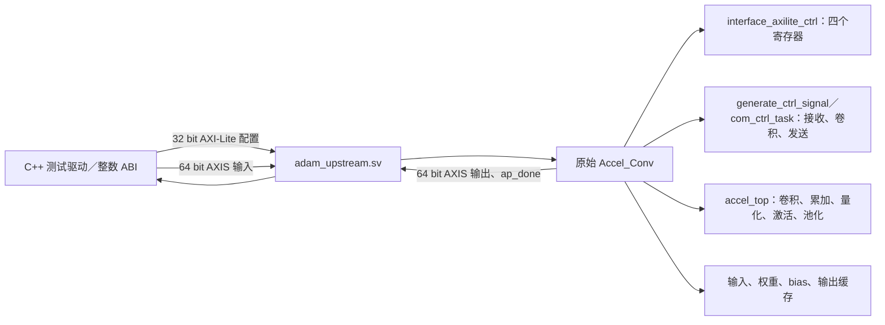

# YOLO 加速器开发交接

> 当前开发分支 `fpga/npu128-uart-bulk` 新增 128 字节权重批量帧，见 [UART_BULK128.md](UART_BULK128.md)。
> 首次候选因帧错嵌套命令反例被拒绝。最终隔离修正版功能、四态网表及 100 MHz 布线通过：
> setup +0.707 ns、hold +0.039 ns，7,733 LUT / 11,715 FF / 82 APM / 126.5 DRM；
> 新位流 12810002 的 JTAG 临时下载/回读通过，用户已按本次 KEY0；同位流旧/批量三组卷积各 12 向量全部一致，
> 零重传；19.091 → 11.401 秒（约 1.67 倍），权重有效吞吐约 6.97 倍，2,759 → 1,538 笔事务。
> 新稳定标签 `baseline/npu128-uart-bulk-20261026` 冻结本阶段，下一步优先 LUT/配置批量装载及整图调度。
> 稳定标签 `baseline/npu128-100mhz-uart-20261026` 固定 `a35cd65`，作为可用基线保留。

> 2026-10-26 主机收包阶段 `fpga/npu128-uart-host` 仅优化主机收包，见 [UART_HOST128.md](UART_HOST128.md)。
> 同位流实板完整流程 77.672 → 18.828 秒，2,759 笔事务、零重传，三组卷积全部输出一致。
> 已从配置丢失状态恢复原 100 MHz 位流，用户已按本次 KEY0；没有改 RTL/约束或重跑 PDS。
> 下一步按实测事务分布实现权重窗口批量写，再验收批量协议和新位流。

> 硬件阶段 `fpga/npu128-mmio-timing` 已把完整板级入口提升至真实 PLL 100 MHz，见
> [MMIO_TIMING128.md](MMIO_TIMING128.md)。分级 MMIO 的 21 任务/674 向量回归、
> 厂商 PLL 整顶层锁定/复位及 200 周期测试、100 MHz 完整 UART 引脚回归和新网表四态回放均通过；
> 完整顶层 100 MHz 布线 setup +0.805 ns、hold +0.039 ns、未布通 0；6,946 LUT / 9,625 FF / 82 APM / 126.5 DRM。
> 新位流 usercode `12810001` 的临时 JTAG 下载/回读及 DONE 通过；本次 KEY0 用户已按。
> COM11 三组卷积实测通过：12 向量、384 个 RAW/INT8 值一致，2,759 次事务、零重传；
> `reports/npu128-uart100-hardware-validation.json` 保存数值、源码与位流绑定及原始日志哈希。
> 原 27 MHz 实板 PASS 作为历史基线保留。

> 实际板卡接续见 [BOARD128.md](BOARD128.md)：27 MHz 诊断位流已生成，PG2L200H 的 JTAG 临时下载、
> 回读、usercode `12802701`、DONE/错误状态通过；KEY0 用户已按。未写 Flash/eFuse。
> 更换数据线并安装已签名 CP210x 驱动后，COM11 的 ID/ABI 与三组卷积实测通过：12 向量、
> 384 个 RAW/INT8 值一致，2,759 次事务、零重传。原 `UART_PENDING` 报告作为历史快照保留。

> 最新分支 `fpga/npu128-uart` 的真实管脚顶层、UART→MMIO 桥及 Python 客户端见 [UART128.md](UART128.md)。
> 27 MHz 原生时钟下，2,777 次事务和三组卷积完整引脚仿真、103 帧字节级 GTP 网表回放通过。
> 真实管脚 PDS setup +20.614 ns、hold +0.039 ns、未布通 0；完整顶层 6,917 LUT / 9,555 FF / 82 APM / 126.5 DRM。
> 新顶层估算 Fmax 60.8902 MHz，MMIO 装载控制路径需后续流水优化，不能视为包含外围的 100 MHz 验收。
> 计算核/MMIO 未修改；原独立 100 MHz 基线保留。UART128.md 保留该阶段实现与仿真边界，未改 hgb。

> 最新分支 `fpga/npu128-mmio` 已完成控制/数据窗口、C11 接口和公开总线端到端仿真，见 [MMIO128.md](MMIO128.md)。
> 19 个任务、672 个输出向量、269,859 次总线事务通过；新外围尚未做 PDS、总线/串口桥或上板，未改 hgb。

> 计算核基线 `fpga/npu128-ramcompact` 的 RAM 映射压缩及接续步骤见 [RAM128.md](RAM128.md)。
> 已恢复此前的内存暂停；模块预规划使原 100 MHz 布线 setup/hold 通过，RAM 为 126.5 DRM。
> setup +0.214 ns、hold +0.037 ns、未布通 0；数值、周期等价、新网表回放及总验收均通过。
> 最新独立物理结果以 RAM128.md 和 `reports/npu128-ramcompact-validation.json` 为准，尚未上板或接入 SoC。

> 后续 `fpga/npu128-prefetch` 已增加双 bank 激活预装载，接口及最新验证见
> [PREFETCH128.md](PREFETCH128.md)。连续像素调度基线见 [THROUGHPUT128.md](THROUGHPUT128.md)。

> 2026-10-24 接手补充：用户已要求恢复 128 MAC 时序优化与独立物理评估。
> 新分支 `fpga/npu128-timing` 的变更、测试及新证据见 [TIMING128.md](TIMING128.md)。
> 以下是 2026-10-23 的历史交接快照，其中“本次暂缓”描述的是当时交付范围。
> 后续 128 MAC 独立布局布线在原 100 MHz 约束下通过 setup/hold，
> 结果与边界见 [IMPLEMENTATION128.md](IMPLEMENTATION128.md)，尚未上板或接入 SoC。

核对日期：2026-10-23。本文对应 `fpga/adam-upstream-faithful` 的实现提交
`971037ac94fdcd619057c0df0049a9216afff3be`；后续文档提交不改变这份 RTL。
目标是电脑传入静态图片，由 RISC-V 管理 YOLOX-Tiny 计算图、调用 FPGA 卷积加速器，
再输出检测框、类别和置信度。Nano 保留为模型备选。图调度继续放在 CPU 软件中。

**本次只补交接文档。未完成的综合、布局布线及上板工作全部暂缓。**
修改范围限于本仓库；hgb、上级三个文档、所有 `AGENTS.md` 和参考资料保持不动。
板卡尚未连接。本文的开发顺序供后续接手使用，不表示其中工作已经执行。

## 1. 接手时先区分三个版本

分支整理后保留 `main`、`fpga/adam-upstream-faithful` 和 `fpga/npu128-bringup`，
用途见 [README 分支说明](../README.md#分支与比较入口)。早期阶段分支已移除，提交仍在
`main` 历史中；下表的图片基线通过保留的标签访问。

| 版本 | 代码与固定位置 | 已有结果 | 尚未完成 |
| --- | --- | --- | --- |
| 当前完整上游 | `fpga/adam-upstream-faithful`，`971037a`；`rtl/upstream/` + `third_party/adamgallas/source/` | 原始完整卷积核的 CSR/AXIS 仿真，576 个 INT8 乘积单元 | Pango 有效综合结果、SoC/DMA 接入、完整 YOLOX 推理、上板 |
| 128 MAC NPU 参考 | `fpga/npu128-bringup`，`f0134a0`；`rtl/adam/` + `rtl/npu/` | 独立卷积与定点后处理仿真、独立 PDS 综合 | 100 MHz 时序收敛、布局布线、完整定点模型 |
| 图片联合仿真基线 | tag `baseline/adam128-image-cosim-20261023`，`658b547` | Tiny 的全部 83 层卷积调用旧 RTL，产生带框图片 | 电脑承担的图操作/浮点处理迁往板端；接入当前完整上游 |

当前分支保留旧代码与图片命令，但 `make test` / `make lint` 已默认选择完整上游。
`make image-detect` 仍选择 128 MAC 后端。不能用该命令的图片结果报告当前 576 路硬件的精度或性能。
旧 NPU 的 5,398 LUT、83 APM、71.88 MHz 也不属于当前完整上游版本。

建议依次阅读本文、[上游接口说明](UPSTREAM.md)、[整数 ABI](../software/adam_upstream_abi.h)
和 [端口驱动测试](../tb/adam_upstream.cpp)。[选型](ACCELERATOR_SELECTION.md)、
[原移植评估](PORTING.md)、[128 MAC](ADAM128.md)、[旧 NPU](NPU.md) 和
[图片仿真](IMAGE_SIM.md) 保留历史设计及复现方法；其中的 128 MAC/INT32 契约不能套用到当前核心。

## 2. 源码来源与修改边界

| 部分 | 来源及固定版本 | 本地位置、许可与用途 |
| --- | --- | --- |
| 完整 CNN 加速器 | [adamgallas/fpga_accelerator_yolov3tiny](https://github.com/adamgallas/fpga_accelerator_yolov3tiny/tree/6ba312bd220e67a987d3417bacd030db30b15770)，提交 `6ba312bd220e67a987d3417bacd030db30b15770` | `third_party/adamgallas/source/`，Apache-2.0；上游 `vivado_prj/source/` 的全部 50 个 RTL 文件 |
| 模型、官方预处理和解码参考 | [Megvii-BaseDetection/YOLOX](https://github.com/Megvii-BaseDetection/YOLOX/tree/6ddff4824372906469a7fae2dc3206c7aa4bbaee)，提交 `6ddff4824372906469a7fae2dc3206c7aa4bbaee` | 忽略目录 `build/upstream/YOLOX/`，Apache-2.0；Tiny 主选，Nano 备选 |
| 完整上游适配层 | 本仓库 `971037a` | `rtl/upstream/adam_upstream.sv` 只透传原参数和端口；`software/adam_upstream_abi.h` 适配原寄存器和数据顺序 |
| 测试与工程脚本 | 本仓库 | `tb/adam_upstream.cpp`、`tools/run_upstream_tests.py`、`tools/pango/`，分别负责独立数值对照、源码核对和 Windows 工程准备 |
| RT-Thread 参考 | hgb 已固定的 [RT-Thread v5.2.2](https://github.com/RT-Thread/rt-thread/tree/ddf52e2cdd977f14fc04035c88672ac204aec713)，提交 `ddf52e2cdd977f14fc04035c88672ac204aec713` | hgb 的 `scripts/rt-thread/fetch.sh` 与 `software/rt-thread/`；没有复制到本仓库，也没有增加 NPU 驱动 |

第三方 RTL 保持原始字节和换行。完整许可证在
[LICENSE](../third_party/adamgallas/LICENSE)，逐文件 SHA-256 与 Git blob SHA-1 在
[manifest.json](../third_party/adamgallas/manifest.json)，取回的 blob ID 在
[upstream-blobs.json](../third_party/adamgallas/upstream-blobs.json)。50 个 RTL 加 LICENSE
共 51 个文件均经过核对。没有导入原工程的摄像头、显示、Vivado bitstream、SDK 或 DDR IP。

Tiny/Nano 的官方权重下载地址、SHA-256、图片 SHA-256 和模型源码哈希分别在
[yolox-tiny.lock.json](../config/yolox-tiny.lock.json) 与
[upstream.lock.json](../config/upstream.lock.json)。`build/` 中的权重、模型依赖、图片和原始
构建日志不随 Git 提交传递；新机器必须按 lock 文件重新取得并核对，不能只复制命令便称为复现。

原加速器服务于 **YOLOv3-tiny**。选择其卷积数据通路后，仍需完成 YOLOX 的算子映射、
量化、分块和软件调度。当前 C 头文件是 ABI 与打包辅助代码，尚非完整 BSP、DMA 驱动或模型执行器。
以后优先在软件和外围接口中适配；若测量表明必须修改原核心，单独记录差异、原因和数值/周期测试，
不要把新地址生成器或新累加规则继续标为“上游原样”。

## 3. 加速器代码架构

### 3.1 顶层与控制路径

当前真实端口连接如下。DDR、CPU 和 RT-Thread 尚未出现在这条已验证路径中。



| 文件或模块 | 作用与接手重点 |
| --- | --- |
| `rtl/upstream/adam_upstream.sv` | 直接例化 `Accel_Conv`；所有参数沿用上游，没有增加 CPU 图调度状态机 |
| `Accel_Conv.v` | 原始 CSR、AXIS、缓存和计算模块的连线；核对控制位和完成语义的入口 |
| `interface_axilite_ctrl.v` | 四个 32 bit 配置寄存器；没有新加的 busy/error/IRQ/status 窗口 |
| `interface_axis_slave.v`、`axis_buf_sel.v` | 输入流分到特征、权重、bias 或激活表 |
| `global_para_gen.v`、`global_data_beat.v` | 形状参数、寄存后的递增地址计数、有效位/地址延迟对齐 |
| `generate_ctrl_signal.v`、`com_ctrl_task.v` | 接收、计算、发送任务及外部 `ap_done`；组合任务完成条件见第 6 节 |
| `accel_top.v`、`module_conv_kernel_1x2*.v` | 完整计算流水和并行卷积乘法层次 |
| `module_acc*.v`、`module_quant*.v` | 18 bit 部分和、首末通道组控制、原版量化规则 |
| `module_relu_1x8.v`、`module_leaky_relu_1x8.v` | ReLU 与可装载的 256 项查表；后者模块名来自上游，不限制只能存 LeakyReLU |
| `module_pool_kernel*.v`、`buffer_ofm.v`、`interface_axis_master.v` | 可选池化、输出暂存和输出流；池化及任意输出背压尚未验证 |

表中未写目录的 RTL 均位于 `third_party/adamgallas/source/`。

### 3.2 MAC 与流水线

这是直接卷积流水：3×3 空间位置 × 8 输入通道 × 8 输出通道，展开 **576 个 INT8 乘积**。
层次为 4 个 `module_conv_kernel_1x2x8`，每个包含 8 个 `module_conv_kernel_1x2`，
每个再含 9 个 `cal_mult_int8_x2`。共 288 个成对乘法单元，每对用两个权重乘同一个激活值。
底层 `cal_mult_int8_x2_dsp` 使用 signed 27×18 打包乘法及借位修正。文件名是
`cal_mul_int8_x2*.v`，模块名中含 `mult`。

```text
输入 ping-pong RAM
  → INT8 零点减法 → 行缓存产生 3×3 窗口
  → 成对乘法（4 拍）
  → 九个空间乘积的加法树（2 拍）
  → 八输入通道加法树（2 拍，末组加入 bias）
  → 18 bit 部分和缓存 → 量化 → ReLU／查表
  → 可选池化 → 输出缓存 → 64 bit AXIS
```

流水寄存器及控制延迟保留上游实现。`global_data_beat.v` 用寄存的 `addr_cnt` 递增取数，
有效位和地址沿流水对齐。以后若确需切分路径，必须一起核对数据、有效位、地址、首末组及完成信号。
当前没有 Pango 最差路径报告，不能提前认定哪一级需要再切一拍。

288 个成对单元是 RTL 展开结果，不能直接换算成 288 个 Pango APM。
Pango 的乘法器宽度、打包识别和 RAM 映射需要实际工具结果。上游
[Xilinx 布线报告](https://github.com/adamgallas/fpga_accelerator_yolov3tiny/blob/6ba312bd220e67a987d3417bacd030db30b15770/vivado_prj/base.runs/impl_1/cam_wrapper_timing_summary_routed.rpt)
中 250 MHz 已约束路径的 setup WNS 为 +0.041 ns；报告也包含无时钟/未约束端点。
该结果只用于了解原平台实现，不能作为 Pango 100 MHz 收敛或整个 SoC 时序完整性的证据。

### 3.3 必须由软件忠实复现的数值规则

1. 输入减零点仍是 8 bit 运算；超范围会回绕。当前回归的零点均为零。
2. 加法树及部分和按 18 bit 补码回绕，范围为 −131072 到 131071；旧 128 MAC 的 INT32
   参考不能直接替代。`first_conv` 控制首组，`last_conv` 控制末组 bias。
3. 量化先饱和到 signed INT16，再乘 signed INT16 scale，按 `15 + shift` 右移，
   `shift` 范围为 0–15；按被舍弃的最高位加一，半值向正无穷方向舍入。
4. 随后饱和到 INT8，再以 8 bit 加法加入输出零点，最后走选定的激活路径。
   非零零点下的完整行为需另加向量，不能按常见量化库的默认顺序代替。
5. scale/shift 是任务级标量；八通道查表共享同一张 256 项表。没有旧 NPU 的逐通道 scale 接口。

建议先建与这些规则逐位一致的 CPU 参考，再导出校准后的权重、bias、scale 和 SiLU 表。
当前测试使用过任意非线性表 `(13*i + 7) mod 256`，只验证查表装载/读出，尚非 YOLOX SiLU 精度结果。
需要检查真实模型各层 18 bit 累加范围与 INT16 截断；极值回绕测试通过不等于模型精度可接受。
若无法用量化/分组方案满足精度，再依据层级误差提出最小硬件变更。

## 4. 软件接口、数据布局与分块

### 4.1 原生 ABI

| 项目 | 约定 |
| --- | --- |
| CSR 偏移 | `0x00` 控制、`0x04` scale/shift、`0x08` 三个零点、`0x0c` 权重/bias 读地址 |
| 输入特征 | 每像素一拍 64 bit，连续八输入通道，通道 0 在最低字节；尾通道补零 |
| 权重 | OIHW `[8][8][3][3]` 转成输入通道优先、再遍历九个 tap；每拍装八个输出通道的权重，共 72 拍/组 |
| bias | 每个 64 bit beat 的低 18 bit 存一个 signed bias，八拍/输出通道组 |
| 激活表 | 256 拍，每拍低 8 bit 为一个表项；同一数据写入八个查表 RAM |
| 任务发起 | `adam_begin_task()` 写配置、动作和 `task_valid` 的按位或，再写 `config` 撤销；每次 MMIO 回调须等写响应完成 |
| 完成 | 外部 sticky `ap_done`，新 `task_valid` 或 reset 清除；当前四个 CSR 没有可轮询的完成状态 |

CSR 控制位和打包函数以 [adam_upstream_abi.h](../software/adam_upstream_abi.h) 及
`Accel_Conv.v` 为准。头文件尚未做完整形状/地址边界检查，调用层必须验证后再提交。
驱动只能有一个配置所有者，任务期间保持形状、bank、量化和读地址稳定，避免启动位长期保持导致重复任务。
新外围需要把 `ap_done` 接成 CPU 可读取/清除的状态与中断，并明确 busy、错误、超时、复位语义。

控制接口宽 32 bit，AXIS 输入/输出宽 64 bit；没有 AXI DDR 主口。
接 hgb 时需适配本地总线/AXI 控制事务的字节地址和写选通，测试 AW/W 分离到达和响应背压。
原 AXI-Lite 接口需同时看到 AWVALID/WVALID 才接收；桥接器须保持或缓存两个通道，不能丢掉先到的一侧。
64 bit 数据打包在 RV32IM 上可用整数指令实现；CPU 的 32 bit MMIO 写入不能假装是原生 64 bit 流握手。

### 4.2 条带与模型布局

默认含边界行宽为 **15、28、54、106、210、418**，并非可任意指定的列数。
每个输入 bank 为 4096 个 64 bit 项。软件需检查 `rows × padded_width <= 4096`，
`rows <= 255`，并与原生行宽选择匹配。416 宽特征若加两侧边界，选择 418；
最多装入 9 行，3×3 无额外填充计算时可得到 7 行内部输出，相邻条带需处理两行重叠。
当前测试不等于已经实现完整图片的条带拼接。

输入/输出通道按八个一组；首尾组标记、输出尾通道丢弃及部分和生命周期由 CPU 描述符控制。
16 输入通道测试目前复用同一份输入/权重做两轮，覆盖累加与末组 bias；
不同通道组的数据、权重地址切换和最大缓存占用仍需补测。

1×1 暂映射为 3×3 中心 tap，其余八个 tap 填零，该层有效乘法比例最多为 1/9。
stride=2、Focus、Concat、上采样、SPP 和检测头需逐项按 YOLOX 官方图适配，
不要把原内建池化等同于 YOLOX 的所有池化/步长语义。先由 CPU 做图操作及必要重排，
在逐层比较之后再优化热点。

Tiny 的 INT8 原始卷积权重为 5,038,272 B（约 4.805 MiB）；Nano 为约 0.855 MiB，
见 [模型统计](../reports/model-comparison.json)。这不包含真实导出后的补齐、1×1 九 tap 展开、
bias、量化表和描述符。建议 Flash/DDR 保存紧凑模型，按当前块展开权重，避免预展开膨胀。
Tiny 无 depthwise，Nano 含 depthwise，后者在当前普通卷积结构上的有效利用率需单独评估。

板卡存储预算参考 [board-budget.json](../config/board-budget.json) 和
[选型报告](ACCELERATOR_SELECTION.md)：片上 DRM 约 1.824 MiB，Tiny 权重不能全驻片上。
板载 Flash 是两片各 16 MiB 的外置芯片；可用模型分区还取决于 FPGA 配置与启动布局，
不能把两片简单视为 CPU 可直接使用的连续 32 MiB。先通过通信把模型放 DDR，后续再接 Flash 加载。
CPU、DMA、NPU 外围和缓存必须合并预算；“Core 约占一半 LUT”继续作为保守规划条件，
不代替同一版本、同一器件的实际资源报告。

## 5. RV32IM、裸机与 RT-Thread 的分工

### 5.1 CPU 不必增加 F 扩展

寄存器访问、DMA 调度、INT8 打包、定点缩放、整数插值、查表、框坐标及整数 NMS 都能在 RV32IM 上实现。
需要 64 bit 中间值时，编译器可组合 RV32 指令；仍应检查溢出和生成的运行库调用。
若暂保留 float/exp/sigmoid，则需要软浮点/数学库和时间预算，不能据此要求硬件一定有 F。
上板前应检查最终 ELF 的指令、链接库和异常路径。当前只有 ABI 的 RV32IM C11 语法检查通过，
尚无整套 NPU 固件的链接或 CPU 执行结果。

已有 hgb RT-Thread 构建采用 `rv${XLEN}im_zicsr_zifencei`，RV32 使用整数 ABI；
调度配置为单核，不生成 A/F/C 指令。实际运行还依赖 CSR、异常/中断和计时器，
“IM 足够做整数计算”不表示只有用户态 IM 指令的任意软核都能直接运行该 BSP。

| 工作 | 建议执行位置 | 当前实际状态 |
| --- | --- | --- |
| 训练、BN 融合、校准、模型导出 | 电脑离线完成 | 官方浮点参考与模型统计已有；当前原核心的完整静态量化未完成 |
| 收图、缩放/填边、布局变换 | RISC-V CPU | 旧图片仿真仍在电脑执行 |
| 图顺序、条带、通道分组、内存生命周期 | RISC-V CPU | 现有测试由电脑 C++ 发任务；板端图执行器待实现 |
| 卷积、部分和、原版量化/激活 | 当前 NPU | 原核心独立卷积流已验证，未接入完整模型 |
| DDR 与 NPU 流之间的搬运 | DMA/流适配外围 | 尚未连接；CPU 轮询搬运可作为早期参考 |
| 框解码、阈值过滤、NMS | RISC-V CPU 初版 | 旧图片仿真在电脑执行；后续按测量结果选定点/查表方案 |
| 显示带框图片 | 初期电脑按板端返回框叠图；后续板端显示 | 电脑画框不应被记为板端解码；板端显示接口未做 |

首轮通信可约定明确的 RGB/BGR 原始像素格式、宽高、长度和校验，减少同时引入 JPEG 解码的变量。
缩放、颜色顺序、填充值和坐标还原需与官方参考一致；改用定点插值后要量化像素与检测框误差。
CPU 性能可以通过预处理、图调度和后处理周期单独展示，无须让 CPU 反复搬运本可由 DMA 执行的数据。

### 5.2 RT-Thread 的价值与使用时机

当前 NPU 仿真运行在电脑的 Verilator/C++ 程序内，既没有运行裸机固件，也没有在 NPU 路径运行 RT-Thread。
hgb 自身已有 RT-Thread BSP 和独立 DMA。只读核对时 hgb HEAD 为
`0febc4bc5dd0cc84caf0756f54ff7d2118bc8fd1`，工作区另有进行中的修改；
本文引用其当时可见的接口，不把整棵工作区视为该提交的干净快照，也不包含它的 NPU 集成验证。

RT-Thread 管理收图、模型任务、完成事件和结果发送；线程等待 DMA/NPU 时阻塞，让 CPU 去处理其他工作。
单核上的多个 CPU 线程仍然分时执行，实际计算/搬运重叠来自 DMA 和 NPU 的独立硬件。
裸机中断加事件循环同样能够实现这种重叠，因此 RTOS 不会自动提高 MAC 吞吐或 DDR 带宽。

建议共用一个与 OS 无关的底层驱动：先用裸机/仿真事件循环跑通“装载→计算→读回”的单任务，
再在现有 RT-Thread BSP 上接信号量与任务队列。这样可用同一工作负载比较调度开销，
也能满足最终展示 CPU 多任务能力的要求。仅看单张图片总耗时，裸机通常少一部分调度开销；
在持续接收、处理和发送时，RT-Thread 更便于维护任务边界和超时恢复，实际速度仍需测量。

推荐的线程职责如下，属于后续实现方案：

| 线程/上下文 | 职责 | 同步原则 |
| --- | --- | --- |
| 收图线程 | 接收分片、校验帧、管理输入缓冲队列 | 缓冲满时对发送端施加协议流控；不覆盖未处理图像 |
| 准备线程 | 整数预处理、准备下一条带和任务描述符 | 只写当前拥有的空闲缓冲 |
| NPU 工作线程 | 唯一 CSR 所有者，运行图顺序、提交 DMA/NPU、管理完成状态 | 等完成时阻塞；禁止其他线程直接改 bank/形状/量化配置 |
| 后处理/发送线程 | 解码、NMS、坐标还原和结果打包 | 仅消费确认写回且完成缓存维护的输出 |
| DMA/NPU ISR | 保存完成原因、确认中断、唤醒等待者 | 保持短小；不在 ISR 做缩放、解码、打印整帧或忙等 |

hgb 当前配置已启用信号量、互斥量；可先用有界环形队列加信号量组织任务。
若使用消息队列或事件集，应先补相应内核配置再测试，不能假设现有 Nano 配置已开启全部 IPC。
硬件超时需保证任务被停止或隔离后再回收缓冲，避免旧 DMA 写入已分配给新任务的内存。

## 6. 并行读取、搬运与计算的条件

### 6.1 可以逐步增加的重叠

CPU 无需在一次推理开始前，把所有层的输入和权重都准备到 NPU 内部。
它可以先提交当前块，再准备下一块，DMA 在独立硬件上搬运，NPU 计算已经就绪的块。
计算图依赖仍须满足：下一层只能消费已产生的输出，条带需补足 halo，Concat/残差需等相关分支数据。

下面是**目标调度示意，尚未实现或验证**。A/B/C 表示不同块，DDR 缓冲和 NPU bank 分别管理。

| 阶段 | CPU | DMA/流适配器 | NPU |
| --- | --- | --- | --- |
| 启动 | 准备 A、描述符和量化参数 | 装载 A | 空闲 |
| 稳态 1 | 在另一个 DDR 区准备 C | 预取 B 到独立缓冲 | 计算 A |
| 交接 | 检查 A 完成，更新所有权 | 回收 A 输出、交付 B；共享通道时排队 | 保持 A 输出直到允许释放，然后启动 B |
| 稳态 2 | 处理已落 DDR 的 A 输出或准备 D | 预取 C | 计算 B |

最先可做的是“CPU 准备/DDR 预取下一块”和“当前 NPU 单任务”重叠，
原核心内部接收、卷积、发送先保持串行。之后再验证跨输入 bank 的并发接收与计算。
若输入、输出 DMA 共享 DDR/AXI 通道，就按仲裁结果计算总搬运时间，不能假设双向始终满速。

理想稳态块间隔接近 `max(T_CPU, T_DMA, T_NPU)` 的前提，是有独立执行资源、足够缓存且无额外依赖；
共享 DDR、缓存维护、任务启动和尾块都会增加时间。单张首帧还包含流水填充与排空。
576 个乘积/拍只是结构峰值，1×1 零 tap、通道尾部、装载和量化均影响实际利用率。

### 6.2 原始硬件中必须先处理的约束

| 约束 | 实现与验收要求 |
| --- | --- |
| 输入双缓存 | `ifmbuf_sel` 选择写 bank，计算读 `~ifmbuf_sel`；重叠期间保持选择稳定，确认读取结束后才能交换 |
| 共享控制寄存器 | `task_valid` 会清除 sticky done，并复位权重/bias 装载计数；当前任务运行时不能把另一次 `adam_begin_task()` 当成互不相关的 DMA 命令 |
| 组合任务完成 | `generate_ctrl_signal.v` 中 `{recv,send,conv}=3'b101` 的 `task_done` 只取 `recv_done`，没有等待 `conv_done`；不得收到 `ap_done` 就释放计算 bank 或改配置 |
| 权重/bias/LUT | 没有独立、已验证的整套双缓冲；计算时不得覆盖正在使用的数据。不同地址预取也需证明读写端口和地址生命周期安全 |
| 权重连续输入 | 装载器每拍移位，九拍 tap 窗口内部不能有空拍；先缓存一个完整九拍窗口或整组 72 拍，再连续送入。仅改软件打包不能消除 DDR 停顿 |
| 输出停顿 | 当前只测试持续 `M_AXIS_tready=1`。先用可容纳一次发送全部输出的捕获缓冲，并在容量不足时禁止启动；或验证完整的可停顿适配。小 FIFO 不能自动吸收任意长 DDR 停顿 |
| 输出存储所有权 | 原输出缓存不能默认当作双缓冲。未读走的数据不得被下一次卷积覆盖；读回完成和卷积完成需分别记录 |
| 输入帧尾 | 保持 TLAST 与最后一个有效 beat 对齐，握手后撤销；需加入断流、异常帧和复位测试，不能泛称原 AXIS 已覆盖全部协议情况 |

当前封装只暴露原有 `ap_done`，尚未提供用于安全并发调度的独立 recv/conv/send 完成状态。
在没有经过测试的独立完成判定前，保留核心任务串行，外围预取可以先推进。
若以后扩展状态可见性，应单独评审最小接口变更并补交错顺序测试，保留计算数据通路及原延迟。

### 6.3 DDR 一致性、DMA 与中断

接手 hgb 时使用 `$HGB_ROOT` 表示其仓库根，参考值为 `../hgb-aisystem_riscv`。
只读参考入口如下，后续移植前重新核对实际分支和本地修改：

| 相对 `$HGB_ROOT` 的路径 | 可复用的经验及边界 |
| --- | --- |
| `vsrc/soc/dma/dma_controller.sv`、`dma_engine.sv` | 已有本地总线/DDR 的内存拷贝 DMA 和块传输分支；没有直接连接当前 NPU 的 64 bit AXIS/TLAST 接口 |
| `tb/soc/dma_block_smoke.c`、`tb/cache/cache_maintenance.h` | CPU/DMA 缓存所有权、异步维护完成和写响应检查；测试 helper 需整理成正式驱动后使用 |
| `software/rt-thread/board.c`、`rtconfig.h` | 中断、Timer tick、单核配置和设备服务；NPU IRQ 尚未加入 |
| `software/common/soc_clocks.h`、`docs/fpga/FPGA_ADAPTATION.md` | Core/SYS/DDR/PERIPH/Timer 多时钟域和软件时基；不能把 NPU 的 100 MHz 测量约束用作全系统固定频率 |

建议给每块缓冲记录地址、有效长度、frame/layer/tile ID、代次及所有者，状态按
`FREE → FILLING → READY → COMPUTING → DRAINING → FREE` 推进；DDR 输入/输出和 NPU 内部 bank
分别记状态，不把它们合成一个笼统的“buffer ready”。异常复位增加代次，丢弃旧完成事件。

CPU 写数据后，按当前 cache 模式完成 clean/flush，再发布给 DMA；DMA 写入的目标在交付前处理旧脏行，
传输完成后由 CPU invalidate 再读取。接管期间禁止 CPU 改写 DMA 拥有的缓存行，尤其是同线的边界字节。
`fence` 处理访问次序，不能代替 cache clean/invalidate 或硬件一致性。
沿用 hgb 已有维护 ABI，先确认操作完成，再切换所有权。

“DMA 输入完成”“卷积完成”“输出流发送完成”“最后一次 DDR 写响应完成”是不同事件。
后处理只能在输出真正可读后开始。ISR 确认/清除与线程检查状态需避免丢失唤醒；
sticky 状态、任务代次、超时和错误码共同完成恢复，不能只等待一个可能错过的短脉冲。
跨时钟域的完成和配置需握手/同步；多位数据走合适的 FIFO/CDC 协议，不能逐位同步后直接拼接。
Timer 超时采用 Timer Hz，UART 分频采用 PERIPH Hz，NPU 性能计时采用自己的时钟或统一时间基准。

## 7. 已有验证与未完成项

### 7.1 当前完整上游的验证

证据为 [upstream-validation.json](../reports/upstream-validation.json)，对应最终提交 `971037a`
中的源码哈希。报告的 `source_base_commit=f0134a0` 是运行当时尚未提交修改的基点，
不是说最终实现仍是该旧提交；重现时以报告的逐文件哈希核对被测内容。

| 检查 | 保存的结果 | 范围 |
| --- | --- | --- |
| 上游一致性 | 51 个文件通过 SHA-256；原 RTL 修改数 0 | 50 个 RTL + LICENSE |
| Verilator 结构 | 288 个成对乘法单元，576 个 INT8 乘积 | RTL 展开结构，不代表物理 APM 数量 |
| 真实端口卷积 | 24 帧、30 次卷积启动、186,144 个 INT8 输出，101,080 个仿真时钟 | 真实 CSR/AXIS 装载与读回，无内部信号强制 |
| 数值/布局 | 六种行宽、8/16 输入通道、1×1/3×3、双 bank、输入特征空拍、bias、极值、18 bit 回绕、饱和、ReLU/查表 | 与独立标量参考逐项比较；双 bank 覆盖不等于并发验证 |
| RV32IM ABI | C11 `-Wall -Wextra -Werror -fsyntax-only` 通过 | 仅头文件语法检查；未链接/运行完整固件 |
| 内存采样 | 构建约 547.6 MiB，执行约 5.25 MiB；单 CPU，约 12.09 s / 10.86 s | 本机一次采样，不是硬件推理延迟或系统内存上限保证 |

未覆盖：非零零点、pooling、任意输出背压、权重窗口空拍、不同通道组内容/地址的完整调度、
内部收取与卷积同时进行、CPU/DMA/NPU 联合运行、RT-Thread NPU 驱动、完整定点 YOLOX 精度和上板。
上游 warning 保留在日志，不能把 `-Wno-fatal` 的运行称为零 warning；测试脚本另检查新 wrapper 无 warning。

### 7.2 PDS 工作保留状态

[upstream-synthesis-attempts.json](../reports/upstream-synthesis-attempts.json) 保存已有尝试和证据哈希。
器件为 `PG2L200H-6IFBB676`，独立顶层为 `adam_upstream`，测量约束为 10 ns。
工程没有板级引脚、CPU/DDR 集成或完整板级时序约束。

| `$PDS_WORK_ROOT/work/` 下的目录 | 已有状态 |
| --- | --- |
| `adam-upstream-576-20261023a` | 1 GiB Job 配额的运行约 34 s 后以 `Flow-0189` 退出，峰值提交计数约 1025 MiB |
| `adam-upstream-576-20261023b` | 2 GiB Job 配额的运行约 340 s 后同类退出，峰值提交计数约 2049 MiB |
| `adam-upstream-576-20261023c` | 已准备工程；3 GiB Job + 4 GiB 保留余量的预检未通过，综合进程未启动 |

两次退出靠近 Job 配额边界，但工具内部原因尚未确定；峰值提交计数可能包含被拒绝的分配，不能当作 RSS。
目前没有本版本有效的 LUT/FF/APM/DRM、Fmax/WNS、综合网表仿真、布局布线、未布通数量或上板结果。
本次不重试，不提高配额继续运行，也不排队等待自动启动。

原始工程与日志保留在 F 盘。未来恢复物理评估时，使用新目录，检查 Windows 可用物理内存和提交余量，
继续只限制本任务进程树；不得为本工程终止其他 hgb/PDS 任务或改系统分页设置。
不要覆盖旧报告，或用修改时钟约束/false path 的方式宣称时序改善。

## 8. 后续开发顺序及验收条件

下列项目均为后续工作。本次文档交付不触发执行；综合、布局布线和下载尤其保持暂缓。

| 顺序 | 工作 | 验收条件 |
| --- | --- | --- |
| 1 | 固定当前原核心，补原生接口边界测试 | 不同输入组/权重地址、非零零点、部分和、尾通道、复位恢复有独立数值参考；明确每个支持的流控条件 |
| 2 | 建立原版 18 bit 量化参考和 Tiny 导出器 | 每层统计回绕、INT16/INT8 饱和、误差；权重布局、bias 和 LUT 与 RTL 逐项一致；输出模型 manifest/哈希 |
| 3 | CPU 图执行器与条带计划 | Focus/Concat/上采样/SPP/stride/halo 正确；跨条带、通道分组、分支内存生命周期通过；同一帧与官方浮点参考比较框与分数 |
| 4 | 最小外围接口和串行驱动 | 状态/IRQ、MMIO 桥、入口预缓冲、输出捕获缓冲和 DMA 连接有端到端测试；先装载→计算→读回，不启用未证明的组合任务 |
| 5 | 复用 hgb BSP，先验证单任务再接 RT-Thread | CPU 真正执行配置/预处理/解码，完整固件以 IM 整数 ABI 链接；记录指令集、ELF/模型哈希；cache/异常/超时可恢复 |
| 6 | 逐级增加并行度 | 先 CPU 准备与 NPU 重叠，再外围 DMA 预取，最后评估内部双 bank 并发；随机完成顺序、DDR 停顿、队列满和复位均不丢数/重用活动缓冲 |
| 7 | 恢复资源/时序评估及上板 | 另行启动独立综合，随后合并系统评估；分别保存资源、setup/hold、最差路径、约束覆盖和布通情况；板上先单卷积再整图 |

软件量化和外围接口可分别准备，但不能在原模型精度尚未知时按峰值 MAC 估计实际检测速度。
也不必等完整 YOLOX、RTOS 并行调度全部完成才上板：未来恢复物理评估后，可先下载原核心单卷积用例，
用实测的资源、路径和数据校验帮助接口开发。这样保留用户希望尽早评估硬件的顺序。

若后续时序不满足，先定位实际路径属于乘法映射、RAM 推断、扇出、控制、跨域还是新外围，
检查上游本已有的寄存边界是否被工具映射保留。优先在外围数据/控制接口增加可验证的缓冲，
核心流水变更必须同步修改有效位和地址延迟并与原版逐项对照。没有物理报告时不预设要重写 MAC 或取数路径。

最终测量应分开记录：通信收图、CPU 预处理、CPU 图调度、DMA 字节数/等待、NPU 有效/空闲周期、
CPU 解码/NMS、结果发送、首帧延迟和连续帧间隔。比较串行与并行版本时固定模型、输入、频率和数据格式。
416×416×3 原始图像有 519,168 字节，仅按 UART 8N1、921600 baud 传输就约 5.63 s，
还未计协议开销；端到端展示必须单列通信时间。精度评估使用多图和明确的数据集，
旧 dog.jpg 演示不能代表 mAP；Tiny 浮点参考对该图的狗曾给出 cat 标签，也应保留这一事实。

## 9. 环境、复现入口与交付范围

| 环境项 | 已用参考值或约定 |
| --- | --- |
| 仿真 | Linux/WSL，Python 3、g++、Verilator 5.052；当前结构检查使用其 JSON 输出 |
| 交叉工具链 | `$RISCV_TOOL_ROOT/bin` 中提供 `riscv64-unknown-elf-gcc`；参考工具链根 `/opt/riscv` |
| Windows PDS | `$PDS_HOME`，参考 `E:\pango\PDS_2025.2-ads`；版本 2025.2 build 211867 |
| PDS 项目根 | `$PDS_WORK_ROOT`，Windows 参考 `F:\pango-project`，WSL 参考 `/mnt/f/pango-project` |
| hgb | `$HGB_ROOT`，相对本仓库参考 `../hgb-aisystem_riscv`；只读，不将其本地修改并入本仓库 |
| RT-Thread | hgb 固定依赖见第 2 节；外部路径由 `$RTTHREAD_ROOT` 指定，默认由 hgb 脚本放入其 `build/` |

未来需要重跑**仿真**时，在仓库根设置工具链 PATH 后执行：

```bash
export PATH="$RISCV_TOOL_ROOT/bin:$PATH"
make test
make lint
```

默认报告在 `build/upstream-faithful/verified/summary.json`；当前保存结果的原始日志在
`build/upstream-faithful/final-clean/`。`tools/run_upstream_tests.py --build-dir <新目录>`
可隔离新结果。脚本固定单 CPU、`-j1`、低优先级和内存/时间保护；Linux RSS 为采样监测，
不会替代 Windows PDS 的物理内存与提交余量检查。本次写文档没有重跑这些仿真。

`make adam-test npu-test`、`make image-detect` 的旧实现说明分别见 [ADAM128.md](ADAM128.md)、
[NPU.md](NPU.md)、[IMAGE_SIM.md](IMAGE_SIM.md)。PDS 的准备/执行/报告收集方法保留在
[UPSTREAM.md](UPSTREAM.md)，仅供后续恢复工作时使用，本次不执行。

接手后先确认分支和源码哈希，再根据第 8 节选择工作。报告中的路径、commit、器件和测试范围必须随新结果更新。
源码保留三条版本边界；已有证明止于这里列出的仿真与历史综合尝试，整图定点、SoC 并行和板端性能等待后续数据。
