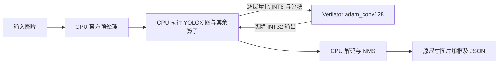

# 图片输入与画框联合仿真

> `fpga/npu128-prefetch` 的图片服务已使用双 bank 装载/计算重叠，协议与数值保持兼容；
> 非零输入拼接回归与完整 Tiny 分块计数见 [PREFETCH128.md](PREFETCH128.md)。下文图片检测精度仍属原基线。

> `fpga/npu128-timing` 已同步更新图片服务的超时和周期断言，图片传输/拼接回归通过。
> 下文整图和图片精度结果仍属于原基线；本轮未重跑完整 YOLOX。新记录见 [TIMING128.md](TIMING128.md)。

当前可以输入 JPG/PNG，运行完整 YOLOX-Tiny 计算图，并输出带检测框的图片。
**83 个 Conv2d 全部使用 Verilator 中的 `adam_conv128`，其他算子由电脑执行。**
没有模拟 RISC-V 指令、UART、DDR 或 AXI，也未上板。
这一步验证图像、逐层卷积、量化衔接和检测输出，后续再将调度及剩余算子移入 SoC。



## 运行方式

先按 [README](../README.md) 准备固定版本的官方源码、Tiny 权重和 PyTorch/torchvision
环境。附加依赖位于 `build/python-deps`。使用该环境中的 Python：

```bash
PYTHONPATH=build/python-deps make image-detect TORCH_PYTHON=python \
  IMAGE=build/upstream/YOLOX/assets/dog.jpg OUTPUT=build/dog-adam128.png

# 替换为自己的图片；空格路径也可用引号传入。
PYTHONPATH=build/python-deps make image-detect TORCH_PYTHON=python \
  IMAGE="你的图片.jpg" OUTPUT=build/my-result.png
```

默认网络输入为 416×416，也支持 `SIZE=320`。原图等比例缩放、放在左上角、右侧与下侧
补 114；BGR、CHW，保持 0–255。画框输出保留原图尺寸，坐标除以缩放比例。
默认置信度阈值 0.25，类别无关 NMS 阈值 0.45。权重/上游源码哈希不符会报错。
现阶段固定 Tiny；Nano 的 depthwise 卷积不在这个执行器的支持范围内。

例如输出路径为 `build/my-result.png` 时：

| 文件 | 内容 |
| --- | --- |
| `my-result.png` | 类别、置信度和检测框；无目标时保存原图 |
| `my-result.json` | 检测框、83 层形状/scale/哈希、硬件周期、整数校验数量、软件与硬件边界 |
| `my-result.png.run.log` | 逐层进度、错误或 PASS |
| `my-result.png.metrics.json` | 整个图片推理进程组的时间和内存采样 |
| `my-result.server.log` | Verilator 传输/协议错误信息，成功时通常为空 |

`make image-sim` 单独编译；源文件、二进制和 Verilator 身份一致时复用已有构建，并保留
原来的构建内存记录。`make image-test` 检查传输、分块和异常请求，不依赖 PyTorch。
全量图片推理默认校验每个卷积的每个 INT32 输出，没有跳过层或软件卷积回退。

若需单独改变置信度或跳过独立整数校验，可在相同资源保护下运行：

```bash
PYTHONPATH=build/python-deps python3 tools/run_guarded.py \
  --rss-mib 1024 --as-mib 16384 --min-available-mib 4096 --seconds 600 \
  --log build/custom.run.log --metrics build/custom.metrics.json -- \
  python tools/detect_image.py --image your-image.jpg --output build/custom.png \
  --confidence 0.30 --nms 0.45 --no-verify-integers
```

`--no-verify-integers` 仅省略对照计算，所有卷积依然在 RTL 上执行。
该例中两个 Python 分别负责内存监护和模型推理；后者须有 PyTorch 环境。

## 数值与硬件边界

每层输入采用一个动态 scale；权重每个输出通道独立 scale，取最大绝对值除以 127。
全零张量使用最小 scale `1e-12`。量化舍入到最近偶数，饱和至 `[-127,127]`，zero-point 为 0。
输入零填充、1×1/3×3、stride 1/2、通道尾块、空间分块和乘加由现有 RTL 执行。
本执行器将硬件 bias 置零，回读 INT32 后由 CPU 按 `activation_scale * weight_scale`
反量化，再加原始 FP32 bias。BatchNorm 保持官方 eval 行为。

CPU 还执行 SiLU、Focus、残差加、Concat、SPP MaxPool、最近邻上采样、Sigmoid、
框解码、NMS 和画框。因此当前图片结果包含浮点运算，动态 activation scale 依赖当前
特征图；它尚不是可烧入 Flash 的静态 INT8 模型。未进行 COCO 校准或 mAP 测量。

传输采用 `sim/adam_image_server.cpp` 的小端 `ADM1` 协议，输入 NCHW、权重 OIHW、
输出 NCHW INT32。C++ 执行器按最多 16×16 输入、16 输出通道切块；按全图坐标填充 halo，
同一输出通道组的权重可在多个空间 tile 间复用。输入/权重均通过真实 RTL 写口写入，
没有直接访问 Verilator 内部 RAM 或以参考值替换硬件返回值。

每个输出核对坐标、mask、last、完成状态及 RTL 计数器；独立标量 INT64 参考直接在
完整输入图上卷积，不使用分块结果。Python 只消费 RTL 返回的 INT32；不支持的层直接报错。
逐层输出哈希、模型/图片哈希和仿真二进制/RTL 哈希写入报告。

## 本次结果

官方 `dog.jpg` 在两个输入尺寸均通过完整计算图：

| 输入尺寸 | RTL 层数 | tile 命令 | INT32 输出逐项校验 | 整次运行时间 | 进程组 RSS 峰值 |
| --- | ---: | ---: | ---: | ---: | ---: |
| 416×416 | 83 | 4,799 | 9,760,257 | 33.78 s | 745.4 MiB |
| 320×320 | 83 | 3,233 | 5,775,300 | 19.75 s | 746.9 MiB |

两个尺寸共检查 15,535,557 个 INT32 输出，全部与独立参考一致。
另有 16 个传输/分块测试，共 115,392 个输出与 NumPy INT64 参考一致，4 个异常请求被拒绝。
覆盖核大小、stride、padding、输入/输出通道尾部、768 输入通道、符号极值和开关独立校验。

416 输入的有效卷积乘加共 3,206,268,000 次；RTL 共执行 41,478,059 拍，
其中包括本地 RAM 装载与命令拍，另有 26,029,380 个 128-lane MAC 发射拍。
这些周期不包含 CPU 算子、软件搬运间隙或未来 AXI/DDR/UART 延迟，不能换算为实板帧率。

416 检测框如下，原图坐标见 [完整验证记录](../reports/image-cosim-validation.json)：

| 实际模型标签 | 联合仿真置信度 | 原 FP32 置信度 |
| --- | ---: | ---: |
| bicycle | 0.8912 | 0.8874 |
| car | 0.7129 | 0.6990 |
| cat | 0.5540 | 0.5552 |

示例中的狗被 Tiny 判成 `cat`。原 FP32 JSON 已是 `class_id=15`，官方类别表索引 15
对应 cat，16 才是 dog；此前 README 中将此写为“狗”，现已更正。画框保留实际预测，
未将标签手动改成 dog。三框与 FP32 参考接近不等于已证明模型精度或量化 mAP。

320 输入得到 dog 0.8129、car 0.7921、bicycle 0.7650。两个尺寸的类别差异也是实际模型输出；
默认仍保留官方 Tiny 的 416 输入。加入 `SIZE=320` 可复现另一张图。
本地输出在 `build/dog-adam128.png` 和 `build/dog-adam128-320.png`，生成图片不纳入 Git。

## 内存与后续

编译和推理顺序执行，`-j1`、单 CPU、nice 19、CPU 推理、无波形。
编译沿用 512 MiB RSS 采样阈值、1 GiB 单进程虚拟地址空间上限。
新增执行器的独立全新构建采样峰值为 350.8 MiB，原始记录保留在
`build/image-cosim/build-validation/`；重复调用命中构建缓存的行为也已检查。
图片阶段含 PyTorch/torchvision/OpenCV，设置 1 GiB 自身进程组 RSS 采样阈值、
16 GiB 单进程虚拟地址空间上限，并保留至少 4 GiB Linux 可用内存。
16 GiB 是虚拟地址空间限额，不是预分配物理内存。

采样周期 50 ms，RSS 可能短暂越过阈值；监护程序超过阈值或 600 秒仅停止自己启动的
进程组。它不监测 Windows 内存，WSL 与 Windows 的可用内存不能混作同一个读数。
本次运行前、结束后只读查询 Windows 可用物理内存均约 15.9 GiB；两个时点的读数不代表
持续监测。未改变 hgb/PDS 或系统内存配置。

后续需要离线校准、BN 折叠、静态 scale 与 requant、剩余算子的软核实现、
AXI DMA/CSR、UART 图像传输，以及 Pango 资源、时序和上板检测。
